# ReAct Agent 介绍

> **说明**：本文中的 ReAct 指 **Reasoning + Acting** 的 Agent 范式（Yao et al., 2022）

---

## 目录

- [一、背景：为了解决什么问题？](#一背景为了解决什么问题)
- [二、简介](#二简介)
- [三、详细思路](#三详细思路)
- [四、还有什么没有解决](#四还有什么没有解决)
- [参考](#参考)

---

## 一、背景：为了解决什么问题？

大模型出现后，让 AI「完成任务」而不是「回答问题」，很快遇到三类瓶颈。ReAct 正是在这些瓶颈上提出的一种经典解法。

### 1.1 纯生成式回答的局限

让模型直接输出答案（Zero-shot / Few-shot）在简单问答上效果不错，但一旦任务需要**外部事实**或**多步操作**，问题就暴露了：


| 问题       | 典型表现               |
| -------- | ------------------ |
| **幻觉**   | 编造不存在的 API、数据、政策条文 |
| **知识过时** | 训练截止日之后的信息无法回答     |
| **无法操作** | 不能查库、不能调接口、不能改文件   |
| **不可验证** | 用户不知道答案依据是什么，难以审计  |


一句话：**模型擅长「像知道一样说」，不擅长「真的知道、真的去做」。**

### 1.2 纯 Chain-of-Thought（CoT）的局限

链式推理（「让我们一步步想」）提升了复杂推理题的准确率，但 CoT 仍然停留在**模型内部**：

- 推理链再漂亮，也**不能替代真实查询**——模型可以「推理」出错误的 SQL 结果。
- 长推理链**不可纠偏**——中间某步错了，后面全错，且没有外部信号打断。
- **无法落地**——想完不等于做完，最后仍要人手动执行。

CoT 解决了「怎么想」，没解决「怎么验证想法对不对、怎么把想法变成行动」。

### 1.3 纯 Tool Use（无显式推理）的局限

给模型接上工具（搜索、查库、发请求）后，能力边界扩大了，但又出现新问题：


| 问题       | 原因                                 |
| -------- | ---------------------------------- |
| **工具选错** | 多个工具功能重叠，模型缺少「为什么选这个」的推理过程         |
| **参数乱填** | 没有先想清楚再调用，SQL / JSON 参数经常格式错误或语义错误 |
| **盲目重试** | 失败后不知道换策略，反复调用同一失败 Action          |
| **难以调试** | 只看到 Action 和结果，看不到决策动机             |


工具给了「手」，但没给「脑和手之间的协调机制」。

### 1.4 ReAct 要填补的缝隙

ReAct 的核心主张是：**推理（Reasoning）和行动（Acting）应该交织进行，而不是分开做。**

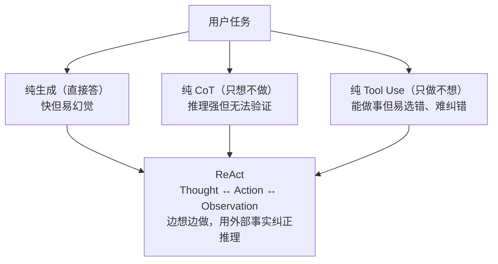


在典型的 Agent 系统中，ReAct 通常作为 **Workflow 中的 Agent 节点** 或 **独立对话 Agent** 的运行范式：用户提需求 → Agent 多轮推理并调工具 → 返回可验证的结论。

---

## 二、简介

### 2.1 定义

**ReAct（Reasoning + Acting）** 是一种让大语言模型通过 **Thought → Action → Observation** 循环完成任务的 Agent 范式。论文 *ReAct: Synergizing Reasoning and Acting in Language Models*（Yao et al., 2022）首次系统提出并验证了这种方法。

每一轮循环包含三个要素：


| 要素     | 英文          | 含义                            |
| ------ | ----------- | ----------------------------- |
| **思考** | Thought     | 模型对当前状态的推理：我知道什么、还缺什么、下一步该做什么 |
| **行动** | Action      | 调用一个工具（或决定直接回答），附带结构化参数       |
| **观察** | Observation | 工具执行后返回的真实结果，写回上下文供下一轮推理      |


循环直到模型输出 **Final Answer**（不再发起工具调用），或达到步数 / 成本上限。

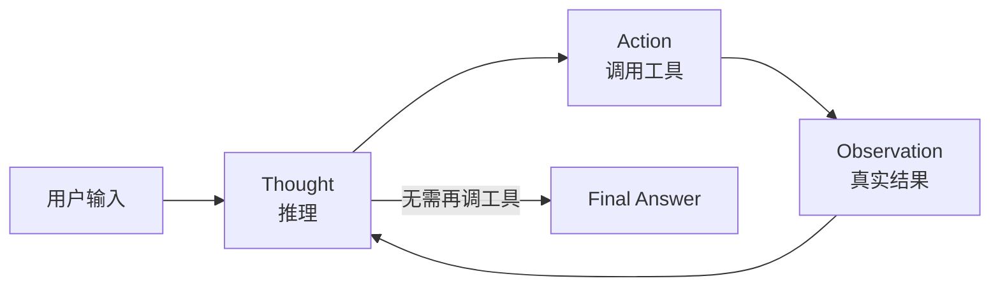


### 2.2 一个完整示例

用户问：「我上周的订单发货了吗？」

```text
Thought: 用户问订单发货状态，但我没有订单号。需要先根据用户身份查最近订单。
Action:  search_orders(user_id="u_42", time_range="last_7_days")
Observation: {"orders": [{"order_id": "67890", "status": "shipped", "eta": "2026-06-18"}]}

Thought: 找到订单 67890，状态已是 shipped，可以直接回答。
Final Answer: 您上周的订单（编号 67890）已发货，预计 6 月 18 日送达。
```

注意：**Observation 必须来自真实工具执行**，不能把模型「想象出来的查询结果」当作 Observation——那是幻觉的另一种形式。

### 2.3 与相关概念的关系

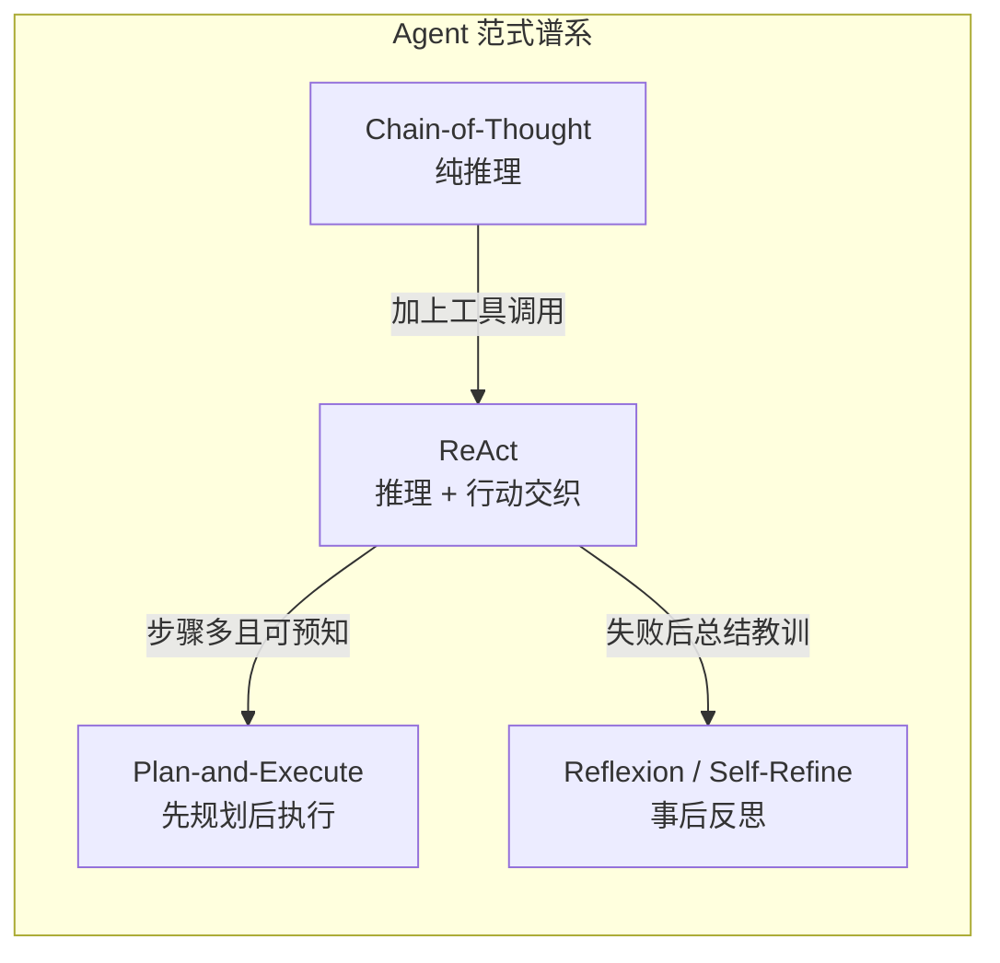


| 范式                   | 特点                       | 适用场景                  |
| -------------------- | ------------------------ | --------------------- |
| **ReAct**            | 每步边想边做，灵活、可纠错            | 开放域问答、检索增强、多工具编排      |
| **Plan-and-Execute** | 先出完整计划，再逐步执行             | 步骤明确、流程固定的任务（ETL、审批流） |
| **Reflexion**        | 任务失败后反思，更新策略再试           | 代码生成、需要多轮自我改进的任务      |
| **原生 Tool Call API** | 模型 API 直接返回 `tool_calls` | 现代生产环境的主流实现方式         |


现代实现里，多数框架不再手写 `Thought:` / `Action:` 文本格式，而是用主流模型 API 的 **原生 Tool Call**。语义上仍是 ReAct，Thought 可能出现在 `content` 或 `reasoning` 字段，也可能被模型隐式完成。

### 2.4 典型落地形态

ReAct 在工程实践中常见以下几种组合方式：

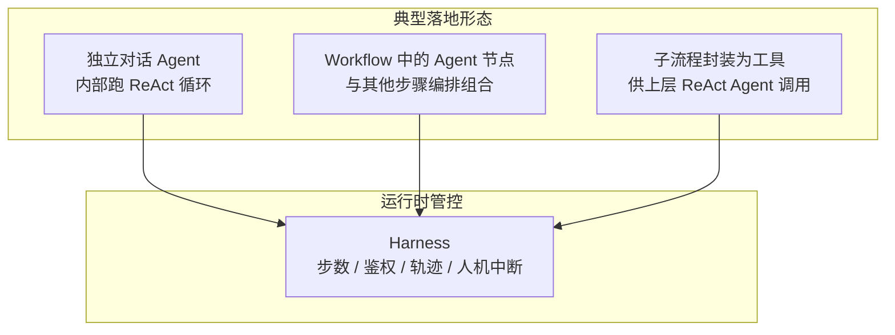


- **独立对话 Agent**：面向用户的聊天式交互，内部跑完整 ReAct 循环。
- **Workflow 中的 Agent 节点**：与确定性步骤（条件分支、数据转换等）组合，适合混合编排场景。
- **子流程封装为工具**：复杂子任务下沉为工具，上层 Agent 通过 Action 调用，保持接口简洁。

ReAct 解决的是「单个 Agent 怎么边想边做」；Workflow 解决的是「多个步骤怎么编排」——两者互补，不是替代关系。

---

## 三、详细思路

### 3.1 核心循环：Thought → Action → Observation

ReAct 的最小执行单元是**单步循环**。Harness（运行时）负责驱动循环，模型负责决策，工具负责产生真实 Observation。

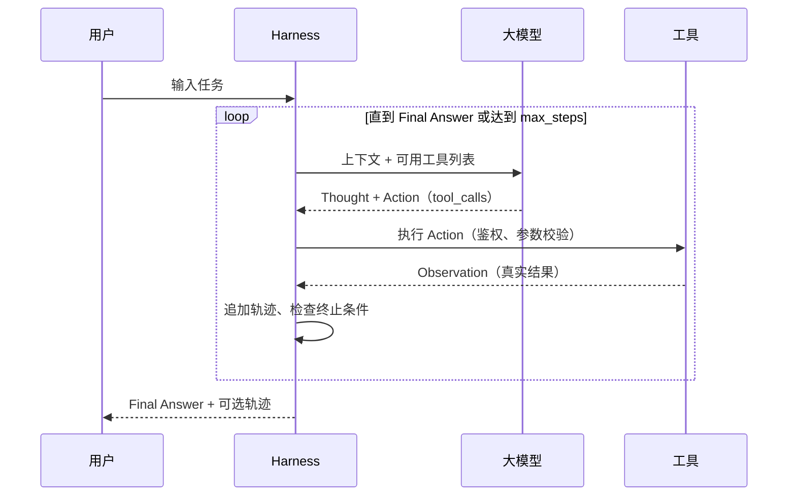


#### 伪代码

```python
def react_loop(user_input, tools, max_steps=10):
    context = [system_prompt, user_message(user_input)]

    for step in range(max_steps):
        response = llm.chat(context, tools=tools)

        if not response.has_tool_calls:
            return response.content  # Final Answer

        context.append(assistant_message(response))

        for call in response.tool_calls:
            observation = tools.execute(call.name, call.arguments)  # 真实执行
            context.append(tool_result(call.id, observation))

    return "达到最大步数，任务未完成"
```

#### 三条设计原则

1. **Observation 必须真实**：工具返回什么就写什么，禁止模型伪造 Observation。
2. **一步一事**：每轮 Action 只做一件原子操作；复杂任务靠多轮拆解，不要一个工具包打天下。
3. **Thought 可显式可隐式**：开发调试时保留完整 Thought 轨迹；面向用户时可只展示进度和最终结果。

### 3.2 职责边界：Agent 不能什么都做

ReAct 的 Action 空间 = 你注册的工具集。工具越多，模型每步的选择越难，出错概率越高。

**职责边界不能无限大**，原因包括：


| 维度    | 无限边界的后果                  |
| ----- | ------------------------ |
| 模型能力  | 答非所问、幻觉、工具选错             |
| 工具与权限 | 鉴权链变长，越权风险上升             |
| 评测    | 没有统一的「成功」定义，无法迭代         |
| 成本    | 每轮要带更多工具描述和历史轨迹，token 爆炸 |


看起来「通用」的产品，底层通常是 **意图路由 → 专门子 Agent**，而不是一个 ReAct 循环注册全部工具。

建议落地时：

- 先用一句话定义 Agent 目标：`用户输入 X → ReAct 循环 → 返回可验证的 Y`。
- 明确 **不做什么**，比罗列「能做什么」更重要。
- 工具分阶段开放：只读 → 可写 → 高风险（加审批）。

### 3.3 工具设计：Action 空间的质量决定上限

ReAct 能做多好，很大程度取决于工具设计，而不是 Prompt 写得有多漂亮。

#### 设计原则


| 原则           | 说明                                        | 反例                         |
| ------------ | ----------------------------------------- | -------------------------- |
| **原子性**      | 一个工具做一件事                                  | `handle_user_request` 什么都干 |
| **描述清晰**     | name + description + JSON Schema 让模型和人都能懂 | description 只有三个字「查数据」     |
| **返回结构化**    | Observation 用 JSON / 表格，关键字段明确            | 返回 5000 字无结构日志             |
| **错误可恢复**    | 失败时返回错误码 + 可操作提示                          | 只返回 `error: true`          |
| **幂等 / 可重试** | 读操作幂等；写操作有幂等键                             | 重复调用创建 3 条重复记录             |


#### 分阶段开放

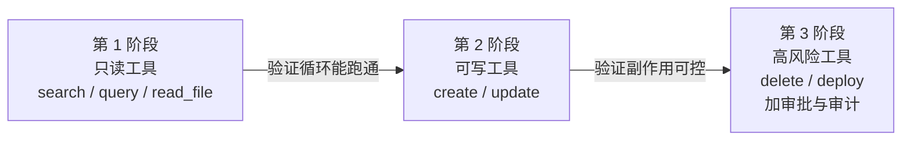


每新增一个工具，都要补对应的评测用例——否则工具越多，整体成功率反而下降。

### 3.4 Prompt 与输出格式

#### 系统 Prompt 应包含

- **角色与目标**：你是谁、要完成什么、成功的标准是什么。
- **ReAct 规则**：何时调工具、何时直接回答、何时承认无法完成。
- **工具摘要**：每个工具能做什么、不能做什么、参数约束。
- **输出约束**：Final Answer 必须引用 Observation 中的数据，不能凭空编造。

#### 两种实现格式

**显式 ReAct 文本格式**（教学 / 小模型 / 无原生 Tool Call API 时）：

```text
Thought: 我需要先查用户最近的订单
Action: search_orders(user_id="u_42", time_range="last_7_days")
Observation: {"orders": [...]}

Thought: 已找到订单，可以回答
Final Answer: ...
```

**原生 Tool Call 格式**（生产环境主流）：

```json
{
  "role": "assistant",
  "content": "我先查一下您最近的订单",
  "tool_calls": [{
    "id": "call_abc",
    "type": "function",
    "function": {
      "name": "search_orders",
      "arguments": "{\"user_id\": \"u_42\", \"time_range\": \"last_7_days\"}"
    }
  }]
}
```

工具结果以 `role: tool` 消息写回，等价于 Observation。Harness 负责解析、执行、注入。

### 3.5 Harness：ReAct 循环的「操作系统」

ReAct 循环本身不能裸跑——需要一层 **Harness（运行时）** 提供约束、安全和可观测性。


| Harness 职责         | 说明                                           |
| ------------------ | -------------------------------------------- |
| **步数上限**           | `max_steps`，防止无限 Thought-Action 循环           |
| **超时与成本**          | 单轮 / 总 token 预算、费用熔断                         |
| **工具路由与鉴权**        | 校验 Action 是否合法、调用方是否有权限                      |
| **参数校验**           | JSON Schema 校验，拒绝非法 Action 并写入错误 Observation |
| **Observation 注入** | 执行工具、格式化结果、写回上下文                             |
| **轨迹记录**           | 完整 Thought-Action-Observation 链，供调试和评测       |
| **循环检测**           | 识别重复失败 Action，强制终止或换策略                       |
| **人机协同**           | 状态中断 + Checkpoint，高风险操作等人确认                  |


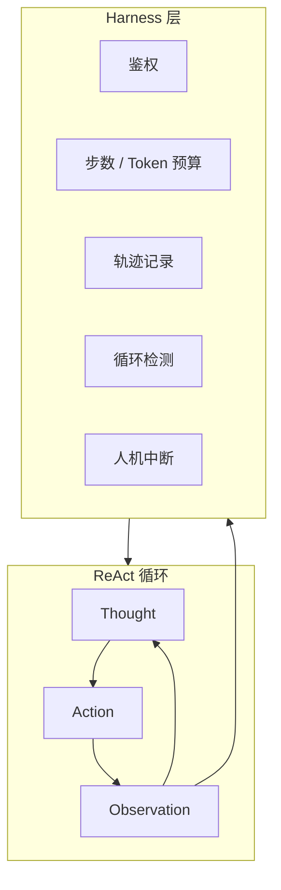


**关键认知**：模型决定「想什么、做什么」，Harness 决定「能不能做、做几次、做错了怎么办」。

### 3.6 上下文与轨迹管理

ReAct 是多轮循环，上下文会快速膨胀。需要区分两层：


| 层级       | 内容                              | 用途       |
| -------- | ------------------------------- | -------- |
| **用户可见** | Final Answer + 必要进度提示           | 产品体验     |
| **内部轨迹** | 完整 Thought-Action-Observation 链 | 调试、评测、审计 |


#### 上下文压缩策略

- **子任务摘要**：已完成的中间步骤压缩为一句结论，丢弃原始 Observation 全文。
- **Observation 裁剪**：超大结果只保留关键字段或前 N 行，完整数据存外部引用。
- **检索增强**：历史轨迹过长时，用向量检索召回相关步骤，而非全量塞入。
- **Run 快照**：每次执行记录输入上下文快照，便于复盘「模型当时看到了什么」。

### 3.7 终止、纠错与兜底

#### 正常终止

- 模型输出 Final Answer（无 tool call）。
- 结构化输出通过 schema 校验（如 JSON 格式、必填字段）。

#### 异常终止与处理


| 情况             | Harness 处理                   |
| -------------- | ---------------------------- |
| 达到 `max_steps` | 返回「未完成」+ 已收集的部分结果            |
| 工具执行失败         | Observation 写入错误信息，让模型下一轮修正  |
| 非法 Action      | 拒绝执行，Observation 提示格式 / 权限错误 |
| 重复失败循环         | 检测后强制终止或注入「请换策略」提示           |
| 成本超限           | 熔断，返回已有进展                    |


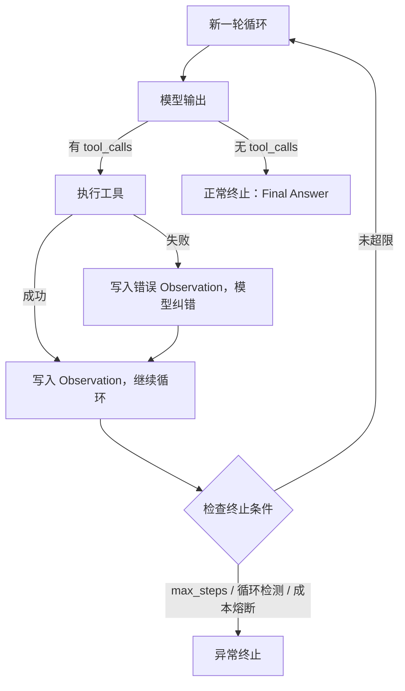


#### 纠错是 ReAct 的核心价值

Observation 把「外部事实」拉回上下文，模型可以在下一轮 Thought 中修正——这是纯 CoT 做不到的：

```text
Thought: 用 order_id=12345 查询
Action:  get_order_status(order_id="12345")
Observation: {"error": "order_not_found"}

Thought: 订单号可能不对，改按手机号查
Action:  search_orders(phone="138****")
Observation: {"orders": [{"order_id": "67890", "status": "shipped"}]}
```

### 3.8 评测与迭代

ReAct Agent 的评测要同时覆盖 **推理质量** 和 **行动质量**，不能只看最终答案。


| 指标             | 含义                         | 为什么重要  |
| -------------- | -------------------------- | ------ |
| **任务成功率**      | 最终答案是否正确、完整                | 用户感知   |
| **平均步数**       | 完成任务的循环轮数                  | 成本和延迟  |
| **工具选择准确率**    | Action 是否调对工具、参数是否正确       | 中间过程质量 |
| **无效循环率**      | 重复失败 Action、空转 Thought 的比例 | 稳定性    |
| **首 token 延迟** | 用户等待第一条回复的时间               | 体验     |
| **轨迹可复现率**     | 相同输入是否产生一致轨迹               | 调试和回归  |


推荐迭代闭环：

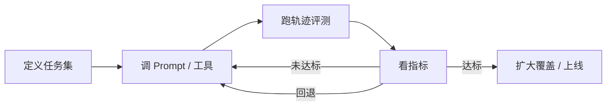


**务必保存完整 ReAct 轨迹**——很多 bug 出在中间某步 Thought 或 Action，只看 Final Answer 会漏掉。

### 3.9 推荐落地顺序

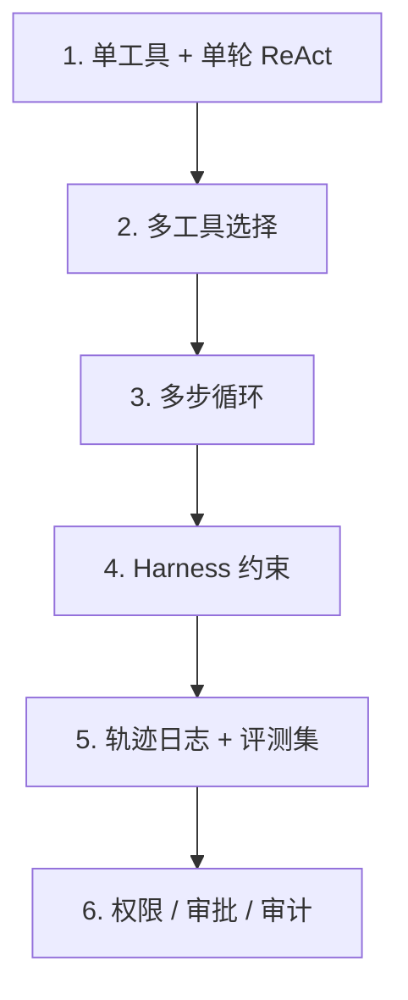


1. **单工具 + 单轮 ReAct**：验证 Thought → Action → Observation → Final Answer 闭环。
2. **多工具选择**：验证模型能在多个 Action 中选对。
3. **多步循环**：验证复杂任务能拆解为多轮。
4. **Harness 约束**：步数上限、超时、循环检测。
5. **轨迹日志 + 评测集**：可复现、可打分。
6. **权限、审批、审计**：高风险 Action 加护栏。

---

## 四、还有什么没有解决

ReAct 是当下最实用的 Agent 范式之一，但远非「银弹」。以下问题在论文发表至今仍是行业共性难题。

### 4.1 可靠性与一致性


| 未解决问题       | 说明                              |
| ----------- | ------------------------------- |
| **同输入不同轨迹** | 温度 > 0 时，相同问题可能走完全不同的工具链，结果时好时坏 |
| **长链路错误累积** | 10 步循环中任何一步 Thought 偏了，后面越纠越偏   |
| **弱模型更脆弱**  | 小模型在工具选择和参数填充上错误率显著更高           |
| **无形式化保证**  | 没有「证明这个 Agent 一定做对」的机制，只能靠统计评测  |


当前缓解手段：低温采样、结构化输出约束、关键步骤人工确认、多路径投票——都是工程补丁，不是理论突破。

### 4.2 成本与延迟

ReAct 天然是 **多轮 LLM 调用**：

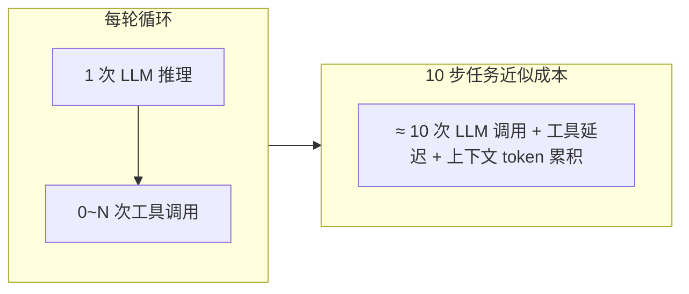


| 痛点            | 影响                     |
| ------------- | ---------------------- |
| Token 随步数线性增长 | 历史轨迹 + 工具描述越积越长        |
| 串行执行          | 多步任务延迟 = 各步之和          |
| 简单问题过度推理      | 「今天星期几」也可能走完整 ReAct 循环 |


未解决方向：自适应早停（判断能否直接答）、轨迹压缩、并行 Action、用小模型做路由大模型做推理——各有 trade-off，没有统一最优解。

### 4.3 评测与回归


| 未解决问题        | 说明                                     |
| ------------ | -------------------------------------- |
| **轨迹评测成本高**  | 完整 Thought-Action-Observation 链的人工标注很重 |
| **工具环境不稳定**  | 外部 API 变化导致历史评测用例失效                    |
| **指标互相矛盾**   | 步数少 vs 正确率高 vs 成本低，难以同时优化              |
| **缺乏行业标准基准** | 不同团队的任务集不可比                            |


Agent 评测仍是开放问题，远不像传统软件单元测试那样成熟。

### 4.4 长程任务与规划

ReAct 是 **逐步决策**，擅长灵活应变，不擅长需要全局规划的长程任务：

- 写一个大功能、做一次完整数据分析、跑一个多阶段审批——纯 ReAct 容易「走一步看一步」迷失方向。
- **Plan-and-Execute**、**LATS（树搜索）** 等变体试图弥补，但规划和执行的切换时机没有定论。
- 超长任务（几十上百步）的上下文管理仍是硬伤。

### 4.5 安全与越权


| 风险            | 现状                             |
| ------------- | ------------------------------ |
| **Prompt 注入** | 工具返回的内容可能劫持后续 Thought          |
| **工具链攻击**     | 恶意 Observation 诱导模型执行危险 Action |
| **权限边界模糊**    | 模型可能组合多个低风险工具达成高风险效果           |
| **审计不完整**     | Thought 是自然语言，难以做自动化合规检查       |


Harness 的鉴权、沙箱、人机确认是必要护栏，但无法覆盖所有攻击面。

### 4.6 多 Agent 协作

单个 ReAct Agent 的边界清晰后，真实业务往往需要多个 Agent 协作：

- 谁负责路由？谁负责执行？谁负责质检？
- 子 Agent 之间的上下文怎么传递？Observation 要不要共享？
- 一个 Agent 的错误如何被另一个 Agent 发现和纠正？

ReAct 本身不回答这些问题。通常需要 **Workflow 编排 + 多 Agent 节点** 来补这一层，但编排范式（串行 / 并行 / 竞争 / 投票）的最佳实践仍在演进。

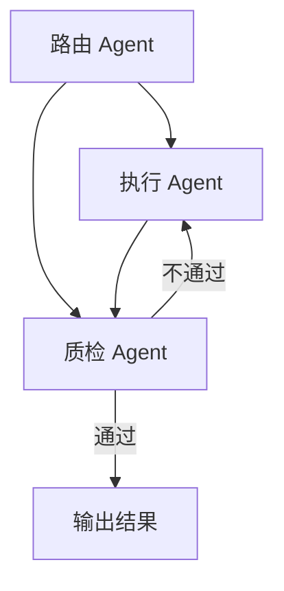


### 4.7 与业务语义的鸿沟

Agent 调工具查到的数据，和业务方理解的「GMV」「活跃用户」往往不是一回事：

- 同名不同义、指标口径不一、文档过时——RAG 捞到片段也拼不出可靠答案。
- 这是 **语义层 / 指标平台** 要解决的问题，ReAct 本身不负责。

ReAct Agent 负责「怎么编排推理和行动」；语义层负责「查到的数是什么意思」——两者需要配合，单独靠 ReAct 解决不了口径问题。

### 4.8 人机协同的体验


| 未解决问题       | 说明                             |
| ----------- | ------------------------------ |
| **何时该问人**   | 模型不知道什么时候该停下来确认                |
| **中断后如何恢复** | Checkpoint 粒度、状态一致性、用户改主意后的重规划 |
| **轨迹可读性**   | 开发者看 Thought 链能调试，业务用户看则一头雾水   |
| **信任建立**    | 用户如何知道 Agent 的结论有据可查           |


状态中断（Interrupt）+ Checkpoint 机制提供了技术基础，但产品层面的交互设计仍是 case by case。

### 4.9 小结：ReAct 的能力边界

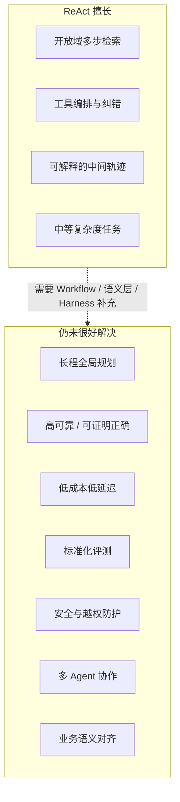


**一句话**：ReAct 解决了「让模型边想边做、用外部事实纠错」的核心问题，但没有解决「做得快、做得稳、做得可证明、做得懂业务」——这些需要 Harness、Workflow、语义层、人机协同和产品设计一起补齐。

---

## 参考

- [ReAct 论文](https://arxiv.org/abs/2210.03629) — *ReAct: Synergizing Reasoning and Acting in Language Models*（Yao et al., 2022）
- [Reflexion 论文](https://arxiv.org/abs/2303.11366) — *Reflexion: Language Agents with Verbal Reinforcement Learning*
- [Plan-and-Solve 论文](https://arxiv.org/abs/2305.04091) — *Plan-and-Solve Prompting*

